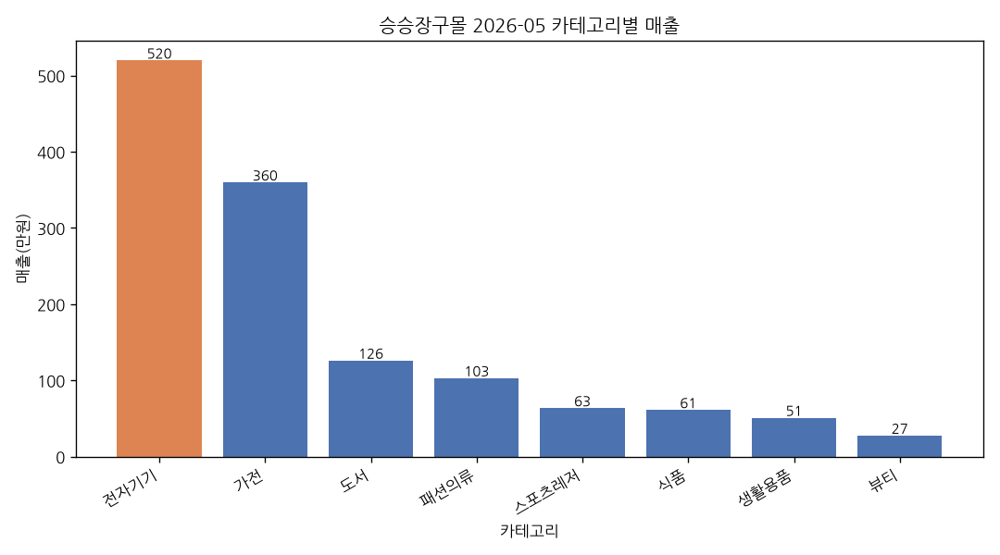

# 2026-05 월간 매출 보고서

> 생성일: 2026-10-14 (자동 생성)

# 월간 매출 요약 리포트 (2026년 5월)

## 총평
2026년 5월의 총매출은 13,106,450원으로, 전월인 2026년 4월의 10,606,500원에 비해 23.6% 증가하였습니다. 이번 달 매출 증가는 주로 전자기기 및 가전 카테고리의 강세에 기인하고 있습니다. 전반적으로 긍정적인 성장세를 보이고 있으며, 향후 지속적인 성장 가능성을 기대할 수 있습니다.

## 카테고리 분석
- **전자기기**: 5,196,000원 (최대 카테고리)
- **가전**: 3,596,050원 (2위 카테고리)
- **도서**: 1,259,200원
- **패션의류**: 1,027,950원
- **스포츠레저**: 634,650원
- **식품**: 610,250원
- **생활용품**: 508,000원
- **뷰티**: 274,350원

전자기기 카테고리는 5,196,000원의 매출을 기록하며 가장 높은 매출을 올렸습니다. 가전 카테고리 역시 3,596,050원으로 2위에 올라, 두 카테고리가 전체 매출의 상당 부분을 차지하고 있습니다. 도서와 패션의류도 일정 수준의 매출을 기록하였으나, 상대적으로 낮은 수치를 보였습니다.

## 다음 달 제언
다음 달에는 전자기기와 가전 카테고리의 성장을 지속하기 위해 프로모션 및 마케팅 전략을 강화할 필요가 있습니다. 특히, 도서와 패션의류 카테고리의 매출을 증대시키기 위한 특별 이벤트나 할인 프로모션을 고려해야 합니다. 또한, 고객의 구매 패턴을 분석하여 맞춤형 추천 시스템을 도입함으로써 전체 매출 증대에 기여할 수 있을 것입니다.